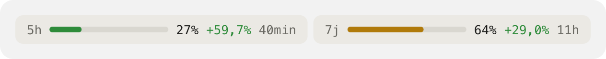
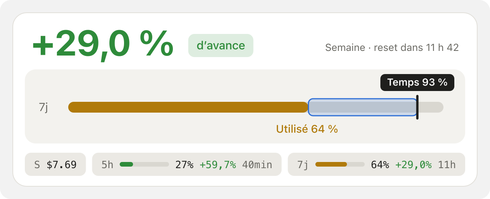
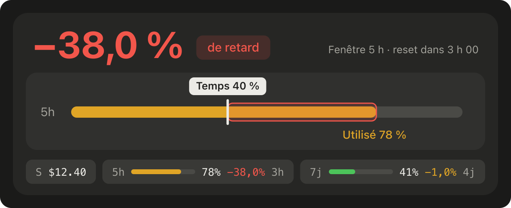

# quotas-claude

Mod Claude Code qui affiche, au-dessus du prompt, la consommation des limites d'un abonnement
Claude : la fenêtre glissante de 5 h et la fenêtre hebdomadaire.

**Version réduite** (par défaut)



**Version complète**, en thème clair (en avance) et en thème sombre (en retard)





*Rendus générés à partir du code du mod, avec des valeurs d'exemple.*

## Ce qu'il affiche

- **Le delta** : temps écoulé dans la fenêtre moins quota utilisé. Positif, tu as de l'avance
  (vert) ; négatif, tu consommes plus vite que le temps ne passe (ambre, puis rouge).
- **Version réduite** (par défaut) : une ligne de pastilles `5h` et `7j`, chacune avec sa
  jauge, le % utilisé, le delta et le temps avant le reset.
- **Version complète** : le delta en grand pour la fenêtre la plus serrée, une grande barre
  avec le curseur du temps écoulé, le coût de la session et les pastilles.
- Les couleurs suivent le thème clair ou sombre de l'app.

Le bouton **Détails** / **Réduire** bascule entre les deux versions sans rien écrire dans la
conversation. `/quotas off` masque la bande, `/quotas` la réaffiche.

## Coût

Aucun token : le mod n'appelle pas le modèle et n'ajoute rien au contexte. Il lit les
pourcentages que l'API renvoie déjà à chaque réponse (`$.session.usage()` et l'événement
`session.measure`). Le coût affiché (`S $…`) est un équivalent tarif API de la session, pas
une dépense réelle sur un abonnement.

Les quotas n'existent que sur un abonnement Claude (Pro, Max) ; ils apparaissent après la
première réponse de l'API dans la session.

## Installation

Dans un terminal Claude Code :

```
/plugin install quotas-claude --marketplace DamienHarper/quotas-claude
```

Répondre `y` pour ajouter le marketplace, puis choisir la portée utilisateur pour l'avoir dans
toutes les sessions.

Depuis un shell :

```bash
claude plugin install quotas-claude --marketplace DamienHarper/quotas-claude
```

Dans l'app desktop : bouton **+** à côté du prompt, **Plugins**, **Add marketplace** avec
`DamienHarper/quotas-claude`, puis **Add plugin**.

## Mise à jour

```bash
claude plugin update quotas-claude
```

puis `/reload-plugins` dans la session.
